# AnkaAI — Inteligencia Colectiva de Trading que se Auto-Mejora

**Versión**: 3.0
**Fecha**: 2026-06-03
**Estado**: Propuesta / Visión arquitectónica (anclada a infraestructura real verificada contra el repositorio, con moonshots etiquetados)
**Nombre de trabajo**: AnkaAI (`anka_ai_learning`)
**Origen**: fusión de la VISION v2.0 (`99-archive/VISION_v2.0.md`) con seis lentes de diseño (propósito, modelo económico, autonomía/auto-mejora de código, colaboración masiva, conexión con dinero real, riesgo/legal) y una verificación exhaustiva del código en producción.

---

## Tabla de contenidos

1. [Resumen ejecutivo](#1-resumen-ejecutivo)
2. [La visión: la narrativa única](#2-la-visión-la-narrativa-única)
3. [Objetivos: los 8 pilares conectados](#3-objetivos-los-8-pilares-conectados)
4. [Principios rectores (no negociables)](#4-principios-rectores-no-negociables)
5. [El flywheel (motor de crecimiento)](#5-el-flywheel-motor-de-crecimiento)
6. [Arquitectura conceptual: lo nuevo sobre lo existente](#6-arquitectura-conceptual-lo-nuevo-sobre-lo-existente)
7. [Pilar central: el embudo darwiniano (P3) y el riel multi-exchange (P1/P7)](#7-pilar-central-el-embudo-darwiniano-p3-y-el-riel-multi-exchange-p1p7)
8. [Modelo económico y levantamiento de capital](#8-modelo-económico-y-levantamiento-de-capital)
9. [Autonomía y autoaprendizaje: el motor de IA](#9-autonomía-y-autoaprendizaje-el-motor-de-ia)
10. [Colaboración masiva humanos + IA y gobernanza](#10-colaboración-masiva-humanos--ia-y-gobernanza)
11. [La educación como flywheel (educar, aprender, expandir)](#11-la-educación-como-flywheel-educar-aprender-expandir)
12. [Seguridad, riesgo, ética, legal y salvaguardas](#12-seguridad-riesgo-ética-legal-y-salvaguardas)
13. [Roadmap por horizontes](#13-roadmap-por-horizontes)
14. [Qué YA existe vs. qué construir](#14-qué-ya-existe-vs-qué-construir)
15. [Métricas de éxito (North Star)](#15-métricas-de-éxito-north-star)
16. [Decisiones abiertas](#16-decisiones-abiertas)
17. [Nota de procedencia](#17-nota-de-procedencia)

---

## 1. Resumen ejecutivo

AnkaAI no es un bot que gana ni una plataforma educativa ni un marketplace de señales: es las tres cosas fundidas en **un solo organismo de capital que se cultiva a sí mismo**. Su metabolismo es una cadena causal cerrada — **conocimiento → capital → más conocimiento** — donde la educación atrae y forma a personas e IAs que generan estrategias, un árbitro estadístico imparcial (el *validation gate* walk-forward OOS, **ya en producción**) deja pasar solo el edge real, ese edge toca dinero real en exchanges en vivo (**KuCoin hoy, `sandbox: false`**), el retorno financia más aprendizaje y eleva el capital bajo gestión, y cada trade — y cada rechazo — engorda un dataset (`feature_store`, ~2.39M filas) que reentrena los modelos y narra nuevas lecciones.

Lo genuinamente único es que **AnkaAI se auto-mejora en dos planos a la vez — estrategias Y código — bajo una jaula de salvaguardas donde la velocidad del flywheel está acotada por el rigor, no por la ambición.** El v2.0 describía un "laboratorio social educativo"; el v3.0 lo eleva a un organismo de **formación de capital** donde educación y dinero real no son módulos paralelos, sino los dos extremos del mismo volante que se financian mutuamente. La mayor parte del *cerebro* ya gira en el repositorio (gate, ML/GBM votante con PF 2.6 OOS, self-learning engine, SessionManager multi-tenant ya **encendido en producción**, custodia cifrada por sobre, app Flutter). La visión no inventa el motor: **conecta lo que ya gira, construye la plomería net-new que falta (Strategy Spec, ExchangeRouter, fund ledger, fee ledger) y abre, con asteriscos honestos, los moonshots** (auto-edición de código del runtime, copy-trading, prop-firm y pools de capital).

---

## 2. La visión: la narrativa única

> *"No construimos un bot que gana. Construimos un organismo que aprende a ganar — y enseña lo que aprende para poder aprender más."*

### 2.1 La metáfora unificadora: el organismo de capital que se cultiva a sí mismo

La mayoría de los productos del sector eligen *un* eslabón de la cadena y se quedan ahí:

- Los **bots** venden rendimiento y ocultan el "por qué" (caja negra).
- Las **plataformas educativas** venden cursos pero no tienen *skin in the game* (enseñan en seco).
- Las **prop-firms** (FTMO, Topstep) financian traders pero no aprenden de ellos a escala.
- Los **marketplaces de señales** (Darwinex, Collective2, ZuluTrade) filtran estrategias y asignan capital, pero el "trader" siempre es humano y el filtro es estático.

**AnkaAI es el único que cierra el triángulo y lo hace co-evolutivo**: cada dólar ganado financia más aprendizaje; cada lección aprendida —por una IA o por una persona— mejora una estrategia; cada estrategia mejorada, y solo si pasa el gate, toca dinero real y genera más capital. La palabra clave es **co-evolución**. No es "IA que reemplaza al humano" ni "humano que usa una herramienta IA": es un ecosistema donde

- las **IAs** generan y mutan estrategias declarativas, reentrenan modelos y —como moonshot— proponen parches a su propio código;
- las **personas** aportan intuición, contexto macro, votan, apelan, enseñan y aprenden;
- el **gate** (validation gate walk-forward OOS, PF≥1.30, ≥60% ventanas verdes — `internal/backtest/validation_service.go`, `validator.go`) es el árbitro imparcial que **ninguno de los dos puede sobornar**.

### 2.2 Qué es AnkaAI que ningún otro sistema es

Tres afirmaciones que, **combinadas**, no las cumple ningún competidor conocido:

1. **Se auto-mejora en dos planos: estrategia Y código.** No solo re-tunea parámetros (eso lo hace cualquier autotuner). Reentrena los modelos GBM (`gbm_60m.pkl`, `gbm_240m.pkl`; `pf=2.611`, `auc=0.816`, `win_rate=0.611` *verificados en `gbm_60m.meta.json`*); las IAs generadoras producirán nuevas *Strategy Specs* declarativas (cuyo runtime hay que construir, §7); y —el moonshot— un bucle de mejora del propio software propone parches al runtime de ejecución.
2. **La transparencia no es un feature, es el combustible.** El bot ya registra el *por qué* de cada decisión (regime gate + ML gate + trend filter EMA50 1h + voto LLM). Ese mismo árbol de decisión alimenta **una sola fuente de verdad — la Explainability API — con cuatro consumidores**: la ejecución real, la sala de educación, los replays y la mejora del prompt del LLM. **Nadie más usa su propia explicabilidad como dato de entrenamiento de su propio modelo.**
3. **El capital escala con el conocimiento, no con el marketing.** Una estrategia no accede a dinero real porque su autor pague más, sino porque **demostró edge fuera de muestra y sobrevivió en shadow**. La promoción capital-virtual→capital-real es una política automatizada y auditada (registrada vía `internal/mcp-trading/server/audit.go`), no una decisión comercial.

El "trader fondeado" puede ser una IA generadora de Specs; el filtro no es estático sino un gate OOS walk-forward que **se auto-mejora** (reentrenamiento + mutación dirigida por datos); y la comunidad no solo compite por el ranking sino que **mejora al propio árbitro** (§10.5). Eso es lo que separa a AnkaAI de un Darwinex con IA.

### 2.3 El norte en una frase

> **AnkaAI es una inteligencia colectiva de trading que se auto-mejora —estrategias y código— donde la educación financia el aprendizaje, el rigor estadístico custodia el capital, y personas e IAs co-evolucionan hasta convertir conocimiento verificado en dinero real, a escala y entre múltiples exchanges.**

Cada palabra está anclada (el estado completo de cada claim vive en la tabla de §3 y en §14; aquí solo el mapeo): *inteligencia colectiva* → multi-tenant + SessionManager + roles; *se auto-mejora* → self-learning engine + pipeline ML/GBM; *la educación financia* → SaaS tiers + Explainability API; *el rigor custodia el capital* → validation gate + risk engine + kill-switch; *dinero real, multi-exchange* → KuCoin live + GoCryptoTrader gRPC; *formación de capital* → marketplace/copy/prop-firm (🌙 moonshot).

---

## 3. Objetivos: los 8 pilares conectados

Los ocho pilares no son una lista plana: son nodos del mismo flywheel. La educación (P5) alimenta la colaboración (P4), que llena el embudo de estrategias (P3), que la autonomía (P6) muta y reentrena, que el dinero real multi-exchange (P1, P7) somete a la prueba final, que genera capital (P8) que vuelve a financiar la educación. La auto-mejora del código (P2) es la **capa meta**: no es una vuelta más del volante, sino la mejora del motor que mueve *todas* las vueltas (por eso aparece fuera del flywheel de §5, a propósito).

| # | Pilar | Conexión en el flywheel | Vive en | Estado |
|---|---|---|---|---|
| **P1** | Generar **dinero real** operando en vivo | La prueba de fuego: lo único que valida que un edge era real | §7.2 | ✅ Real (KuCoin live) |
| **P2** | Mejora continua del **código** por IAs | Capa meta: engorda el motor que mueve P3–P7 | §9.3, §9.4 | 🌙 Moonshot (en jaula) |
| **P3** | Mejora continua de **estrategias** | El producto del embudo; lo que P1 somete a prueba | §7.1 | 🟡 Gate real ✅; **generador de Specs ❌ net-new** |
| **P4** | **Colaboración masiva** IA+personas | La fuente de varianza que llena el embudo de P3 | §10 | 🟡 Roles existen; falta capa social + Spec |
| **P5** | **Educar, aprender, expandir** | El motor de adquisición de contribuyentes para P4 | §11 | 🟡 Materia prima existe |
| **P6** | **Autonomía y autoaprendizaje** | El cierre del bucle que muta P3 y reentrena modelos | §9 | 🟡 Implementado, default OFF |
| **P7** | Dinero real y **múltiples exchanges** | La anchura del riel donde corre P1 | §7.2 | 🟡 KuCoin real; **ExchangeRouter de ejecución ❌ net-new** |
| **P8** | **Levantar capital** (pools, copy, prop-firm) | El retorno que financia P5 y escala P1 | §8 | 🟡/🌙 SaaS real; resto net-new/legal |

---

## 4. Principios rectores (no negociables)

1. **El gate es soberano; nadie lo soborna.** Ninguna estrategia —humana o IA— toca dinero real sin pasar el validation gate OOS, sobrevivir en shadow y obtener aprobación auditada. El gate es código determinista (`validator.go`, `MinProfitFactor=1.3`, `MinConsistency=0.6`), jamás una opinión del LLM. **La IA nunca califica su propia estrategia.**
2. **La velocidad del flywheel está acotada por el rigor.** El gate es el único punto donde el volante puede *frenar*, y es deliberado. Convierte "un volante que gira rápido hacia la ruina" en "un volante que solo acelera cuando hay edge demostrado".
3. **Skin in the game obligatorio.** Ninguna Spec accede a copiadores ni a capital ajeno sin que su autor la haya corrido primero en su propia cuenta con dinero real. El autor siempre pierde primero. Esto mata el spam de estrategias sobreajustadas.
4. **El dinero fluye solo desde el PnL realizado y verificado**, registrado en `trade_history`, marcado a high-water-mark en `portfolio_snapshots`, **reconciliado contra el exchange (no contra SQLite)**. No hay sistema financiero separado del de trading: el libro de PnL *es* el libro contable.
5. **El default de todo lo nuevo es `OFF`.** Igual que ya hace el repo con `bot.learning.enabled=false`, el self-learning engine y el Active Profit Engine (gated por config dinámica `/reload`). No se enciende lo que no se puede frenar. **Excepción peligrosa ya viva:** `multi_user.enabled=true` ya está encendido en producción (§12.0) — no todo lo riesgoso está OFF, y eso obliga a tratar ciertos gaps como exposición presente.
6. **El humano define la jaula; la IA juega dentro.** El autoaprendizaje tunea umbrales dentro de rangos duros inmutables (como el `WickLearner` con el threshold 1.0–4.0). La IA **jamás** modifica sus propios límites de riesgo ni desactiva el kill-switch.
7. **La plasticidad es inversamente proporcional al radio de explosión.** Parámetros se promueven en minutos; estrategias en horas tras gate+shadow; código en días tras CI + revisión humana + canary.
8. **Transparencia post-hoc obligatoria.** Toda decisión con dinero real debe poder reconstruirse vía la Explainability API. "La IA decidió y no sé por qué" es legalmente indefendible y éticamente inaceptable cuando hay dinero de un tercero.
9. **Disciplina de documentación.** Un documento solo nace si desbloquea código (heredado del v2.0 §12). Anti-sobredocumentación.

---

## 5. El flywheel (motor de crecimiento)

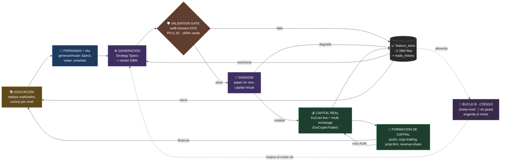

**Las cinco vueltas que se refuerzan (más el meta-bucle):**

1. **Vuelta del conocimiento**: la educación atrae y forma personas+IAs → generan más y mejores estrategias.
2. **Vuelta del rigor**: toda estrategia pasa por el gate → solo el edge real llega a shadow y solo lo estable a dinero real. **El fracaso también enseña**: los rechazos engordan el dataset.
3. **Vuelta del dato**: cada trade real (y cada rechazo) engorda `feature_store` → reentrena modelos y narra nuevos replays.
4. **Vuelta del capital**: el dinero real genera retorno → financia educación y eleva el AUM validado.
5. **Vuelta de la colaboración**: la formación de capital recompensa a los autores top → incentivo para enseñar, mutar y competir.
6. **Meta-bucle (P2, fuera del volante a propósito):** el Bucle B no es una vuelta del volante; se alimenta del **mismo dataset** y **engorda el motor que mueve todas las vueltas** (mejora `decision.go`, indicadores, executors). Está separado porque opera a meta-nivel y tras una jaula (§9.3), no por omisión.

**La expansión, medible:** el flywheel no crece en abstracto. La *vuelta del conocimiento* es, operativamente, un embudo de adquisición — **alumno → autor de Spec certificada → originador de edge → AUM-Certificado** (§11, §15) — y "expandir" (P5) significa ensanchar ese embudo por cohortes de educadores, idiomas y jurisdicciones soportadas (§12.6), no solo "más usuarios".

> **Insight clave**: el gate es el único punto de frenado del flywheel, y es deliberado. La velocidad está acotada por el rigor, no por la ambición.

---

## 6. Arquitectura conceptual: lo nuevo sobre lo existente

Verde = existe y opera. Azul = nuevo (construible sobre lo verde). Magenta = net-new no trivial. Naranja punteado = moonshot.

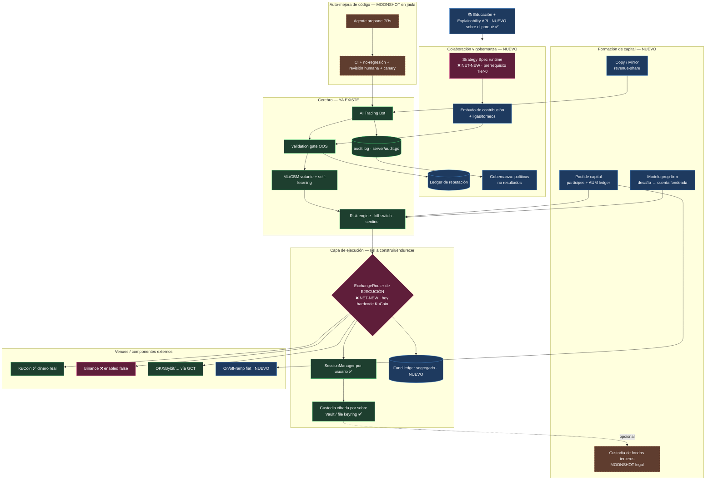

**Lectura honesta**: el cerebro (gate + ML + risk + audit) y parte de la capa de ejecución (SessionManager, custodia cifrada, KuCoin live) **ya existen y operan**. Pero hay tres piezas **net-new no triviales** marcadas en magenta — la **Strategy Spec** (no existe ningún tipo, parser ni runtime; `grep StrategySpec` devuelve cero), el **ExchangeRouter de ejecución** (lo que hay, `internal/exchange/router.go`, es una superficie *read-only* de observabilidad; la ejecución sigue clavada a `c.kucoinClient`) y el **fund ledger**. Lo moonshot (auto-edición de código, custodia de terceros, SOR, pools tokenizados) está deliberadamente aislado y etiquetado.

### 6.1 AnkaAI reutiliza servicios de plataforma RantiPay ("integrar, no reimplementar")

AnkaAI no vive sola: la plataforma RantiPay ya provee servicios productivos que AnkaAI **reutiliza en vez de reconstruir** (regla del repo: integrar, no reimplementar). El análisis completo, con matriz build-vs-reuse y evidencia por archivo:línea, está en **[ARCH-PLATFORM-REUSE](../03-architecture/PLATFORM_REUSE.md)**. Resumen del mapeo:

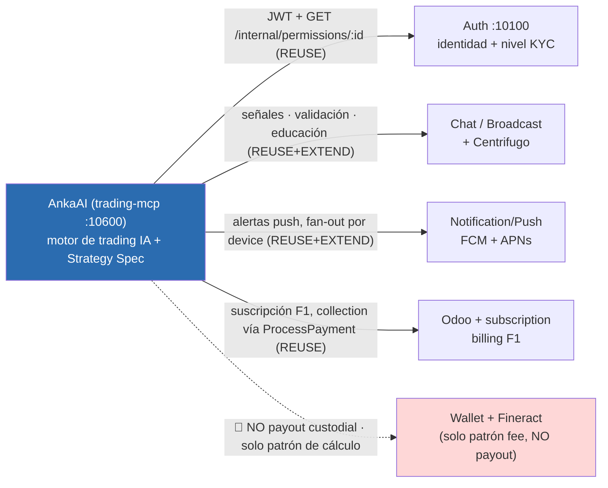

| Necesidad AnkaAI | Servicio de plataforma | Fit |
|---|---|---|
| Identidad / login | Auth :10100 (JWT `user_level`, `GetTenantID`) | **reuse** |
| KYC por nivel de capital | Auth `GET /api/v1/internal/permissions/:userID` | **reuse+extend** |
| Alertas (señal, validación, payout) | notificationpush (FCM/APNs) + Centrifugo `personal:{user}` | **reuse+extend** |
| Educación masiva + mensajería | Chat `POST /internal/broadcasts` + `internal/filemanagement/messaging` | **reuse+extend** |
| Cobro suscripción F1 | Odoo + `internal/subscription` (ya integrado) | **reuse** |
| Performance fee F3 (accrual) | patrón `FeeService` — accrual read-only en trading-mcp, **NO** Fineract | **build-new (patrón reutilizado)** |
| Payout / profit-split F2/F3 | 🔴 **NOT-A-FIT** — Fineract custodial cruza la frontera non-custodial (§12.5) | **bloqueado (legal-gated)** |

**Sigue siendo net-new** (la plataforma no lo aporta): Strategy Spec, ExchangeRouter de ejecución, fee/fund ledger propio, copy-orchestrator. La **línea roja custodial** (no mover fondos de terceros por Wallet/Fineract) se detalla en [ARCH-PLATFORM-REUSE → Frontera custodial](../03-architecture/PLATFORM_REUSE.md#frontera-custodial--la-línea-roja) y es coherente con §12.5.

---

## 7. Pilar central: el embudo darwiniano (P3) y el riel multi-exchange (P1/P7)

### 7.1 Mejora continua de estrategias (P3) — el embudo darwiniano

El contrato de entrada es la **Strategy Spec declarativa** (YAML/JSON inmutable): las IAs y los humanos generan *Specs*, no Go. Esto eliminaría ~90% del riesgo de seguridad de "IAs con acceso al código", haría los rankings comparables (mismo runtime para todas) y reduciría la superficie de ataque casi a cero.

> **⚠️ Dependencia Tier-0 bloqueante — la Strategy Spec NO existe todavía.** Verificado contra el repo: no hay tipo `StrategySpec`, ni parser, ni esquema, ni runtime que ejecute una Spec (`grep -rln StrategySpec internal/ cmd/` → cero; sin archivos `*spec*.go`). El v2.0 la listaba como "pieza fundacional" pero también como *documento a crear*; el v3.0 NO la hereda como infra real. **Es el cimiento a construir primero**: P3 (generador), P4 (colaboración), el copy-trading (F2), el sandbox de Specs y la gobernanza dependen de él. Sin el esquema del Strategy Spec, nada del embudo arranca — es el primer documento a redactar (`docs/specs/STRATEGY_SPEC.md`) y el primer runtime a construir. El `feature_suggester.go` NO es este seam: sugiere *features* para el GBM, no emite Specs ejecutables.

El embudo es un proceso darwiniano: generación → validation gate (mata ~90% de las variantes; en la primera corrida real solo SEI quedó certificado de 10 pares — *eso es bueno*) → shadow → micro-capital real → escalado. El scoring **no maximiza PF a secas: penaliza el overfitting**, prefiriendo "PF 1.4 estable en 9/10 ventanas" a "PF 3.0 en 5/10". La materia prima del gate ya existe (`validator.go`, `model_registry` con `status/shadow/promoted_at`, verdicts con TTL que desacertifican edges decadentes); lo que falta es el sustrato (la Spec) que lo alimente a escala.

**Idea audaz — "Liga de Specs con presión de mercado real":** cada Spec certificada recibe una micro-asignación de capital real rotatoria. Los `risk_limits` actuales (`max_order_size_usd: 2.0`, `max_daily_loss_usd: 5.0`) son útiles como **freno**, pero son límites de *testing con $5* (comentario literal del config), no límites de producción diseñados. El ranking no se computa solo de backtest sino de **PnL realizado en vivo a escala mínima**, cerrando la brecha "backtest miente / paper miente" documentada repetidamente en la bitácora (PnL inflado, cierres externos no registrados). Escalar a AUM real exige un sistema de risk-limits **jerárquico por tier/tenant/Spec** que hoy NO existe a ese nivel (§14).

### 7.2 Dinero real (P1) y múltiples exchanges (P7) — el riel

Ya tenemos la pieza más difícil y cara: **una tubería de ejecución que mueve dinero real en KuCoin hoy** (`config.yaml`: `mode: production`, `sandbox: false`), con custodia de claves cifrada por sobre y aislamiento por usuario (SessionManager, ya **encendido**: `multi_user.enabled: true`).

#### 7.2.1 El riel multi-exchange: hoy es un carril único

Honestidad cruda: **el multi-exchange NO está "configurado a medio camino"; es net-new completo.** En `config.yaml`, `binance` está `enabled: false` — **solo `kucoin` opera**. Y `internal/exchange/router.go` se auto-describe como *"read-only multi-exchange observability primitives… performs NO order placement"*: sirve para una matriz de precios y selección de mejor venue, **no para enrutar órdenes**. La ruta de ejecución viva está cableada a `c.kucoinClient` (`internal/gct/client.go:468`, `671`, etc.) sin ninguna rama Binance.

El **ExchangeRouter de ejecución** (P7) es, por tanto, una de las tres piezas net-new del sistema. Su contrato:

- **Abstracción sobre GCT, no sobre KuCoin.** Hoy `*gctclient.Client` expone GoCryptoTrader (cabida ~24 venues) pero las llamadas de *placement* invocan directamente `c.kucoinClient`. El Router define una interfaz `PlaceOrder/CancelOrder/GetPositions` resuelta **por venue** a partir de la sesión del usuario, no de un cliente global.
- **Estrategia de migración del hardcode.** Sustituir cada `c.kucoinClient.XXX` de la ruta de ejecución por `router.For(exchange).XXX`, donde `router` resuelve el adapter (`kucoin` ✅ existe; `binance` ❌ a implementar sobre GCT). Empezar por *lectura* (ya hay superficie read-only) y luego *escritura* tras tests de paridad.
- **"Enrutar de verdad" Binance/OKX** = un adapter por venue que normaliza símbolos, tamaños de contrato, modos de margen y *clientOrderId*, con tests de paridad contra el comportamiento KuCoin actual antes de tocar dinero real.
- **Por qué el SOR es moonshot pero el routing básico no:** enrutar la orden al *único* exchange donde el usuario tiene cuenta es plomería (H2). El **Smart Order Routing** (partir una orden entre venues por mejor precio/liquidez, arbitraje cross-exchange) requiere AUM que lo justifique y latencia/inventario multi-venue: 🌙 H3.

El detalle del **fund ledger e idempotencia** que protege ese riel está en §8.8 (no es una promesa colgada: se desarrolla allí, con `clientOrderId` determinista, subaccounts y reconciliación contra el exchange).

---

## 8. Modelo económico y levantamiento de capital

**Por qué esto NO es Darwinex/FTMO/Collective2 (el titular, antes de las tablas):** las tablas de tiers, profit-split y 2/20 de abajo *parecen* las de cualquier prop-firm o marketplace de señales — y deliberadamente reutilizamos lo que la industria ya validó legal y operativamente. La diferencia estructural está en **qué** corre por esa tubería: (1) el "trader fondeado" puede ser una **IA generadora de Specs**, no solo un humano; (2) el filtro de asignación de capital es un **gate OOS walk-forward que se auto-mejora** (reentrenamiento + mutación dirigida por datos), no un screening estático de métricas; y (3) la **explicabilidad de cada trade retroalimenta el modelo** que genera los próximos edges. Darwinex filtra humanos con un filtro fijo; AnkaAI cultiva un generador de edges (IA+humano) bajo un filtro que evoluciona. Esa es la categoría propia.

### 8.1 Punto de partida honesto: lo que YA factura

`internal/subscription/` ya implementa una máquina de cobro real (precios verificados en `subscription/models.go: MonthlyPrice()` líneas 79–83; límites por tier líneas 172–221; facturación cableada a Odoo vía `webhook.go`):

| Tier | Precio/mes | `MaxBots` | `MaxExchanges` | `MaxOrderSize` | `FeatureRealTrading` |
|------|-----------|-----------|----------------|----------------|----------------------|
| Free | $0 | 0 | 1 | $100 (paper) | ❌ |
| Basic | **$19** | 1 | 2 | $10.000 | ✅ |
| Pro | **$49** | 5 | 5 | $100.000 | ✅ |
| Enterprise | **$199** | ∞ | ∞ | ∞ | ✅ |

Esto es revenue de suscripción SaaS: predecible, sin asumir riesgo de mercado, pero lineal y bajo (1.000 usuarios Pro ≈ $49k/mes — negocio sano, no palanca). **La palanca está en monetizar el rendimiento del capital, no el acceso al software.**

### 8.2 Los cuatro flujos de dinero

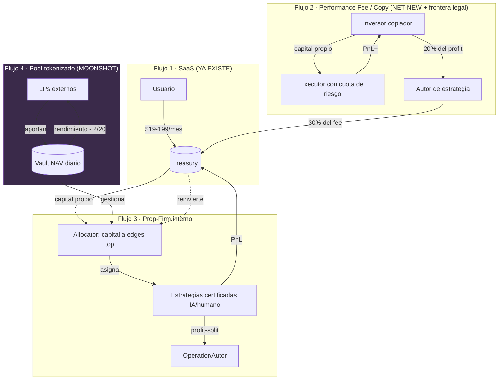

### 8.3 Flujo 2 — Copy-trading sin custodia: el primer dinero "no lineal"

Un autor registra una Spec, pasa el gate, y otros usuarios la "copian" con su propio capital real. El autor cobra performance fee solo sobre el PnL positivo de sus copiadores.

- El `SessionManager` (`internal/gct/session_manager.go`) ya aísla credenciales por `userID:exchange` — pero **eso es solo el sustrato**. NO existe ningún orquestador N-sesiones, ni replicador de señal, ni motor de copy, ni accounting de HWM (`grep copy/mirror/orchestrat` → nada). La ejecución del copy es **net-new no trivial**.
- `portfolio_snapshots` por usuario (migración 014, `idx_portfolio_snapshots_user_time`) sería el **libro del high-water mark**: el fee solo se cobra sobre ganancia *nueva* sobre el máximo histórico — pero el fee ledger en sí hay que construirlo.
- `trade_history` con PnL y fees reales (tras el fix `notional=|pnl|/(|pnlPct|/100)`) es la **fuente de verdad auditable**.

**Estructura del fee (propuesta):** `20% × max(0, PnL_periodo − HWM_anterior)`, repartido 70% autor / 30% Treasury. **Gate anti-abuso (load-bearing):** una Spec solo es copiable con dinero real si tiene verdict `certified` vigente, ha corrido ≥30 días con capital propio del autor (skin in the game) y los gates ML+régimen están activos.

> **Reutilización + frontera custodial ([ARCH-PLATFORM-REUSE](../03-architecture/PLATFORM_REUSE.md)):** el cálculo del fee/HWM puede reusar el patrón `internal/wallet/service/fee_service.go`, pero el **accrual vive read-only en trading-mcp** (DECISIONS §3) y la **collection va por `pkg/client/odoo.ProcessPayment`** contra el método de pago del copiador — **nunca** por `WithdrawToIssuer`/Fineract. El **payout/profit-split de F2 es NOT-A-FIT con la arquitectura actual** (mover saldos entre cuentas Fineract custodiadas cruza la frontera non-custodial) y queda legal-gated hasta partner licenciado (§8.5).

> **🚨 Frontera regulatoria seria, NO "borderline".** Cobrar *performance fee* sobre el PnL de cuentas de terceros casi siempre activa régimen de **asesor/gestor de inversiones**, independientemente de que haya o no custodia. No basta con "no tocamos los fondos". **Exige opinión legal ANTES de cualquier prototipo con dinero de un copiador real.** El único flujo sin duda legal hoy es F1 (SaaS) + el bot operando la cuenta propia del propio usuario con sus propias keys.

### 8.4 Flujo 3 — Prop-firm interno: AnkaAI arriesga SU propio capital en los mejores edges

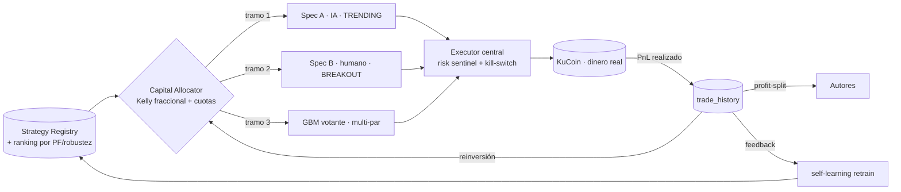

- El **Capital Allocator** es extensión natural del `internal/scalping/coordinator/` (que ya decide qué bots spawnear): hoy reparte *slots de bot*, mañana repartiría *dólares* con Kelly fraccional ponderado por el robustness score del gate.
- El **risk sentinel** (`sentinel.go`, `liquidation_guard.go`), el clasificador dinámico de volatilidad y el kill-switch son exactamente los guardrails de un prop-firm: cuota de riesgo por estrategia, drawdown máximo por tramo, corte automático.
- El **self-learning engine** cierra el bucle: las estrategias que pierden capital pierden ranking → menos asignación → reentrenamiento o retiro. Selección natural con presupuesto real.

**Capital progresivo (virtual → real)** — el modelo prop-firm clásico aplicado a estrategias en vez de a traders, indistinto para IA o humano:

| Etapa | Capital | Condición de ascenso |
|-------|---------|----------------------|
| Paper | $0 (Free, `MaxOrderSize=$100` simulado) | Beat gate OOS |
| Seed | $200-500 reales del Treasury | 30 días live, PF≥1.3, DD<10% |
| Funded | $2k-10k | 90 días, Sharpe>1, ≥60% ventanas verdes |
| Scaled | $25k-100k+ | track record auditado + revisión humana |

El profit-split sube con la etapa (ej. 50% en Seed → 80% en Scaled). **Técnicamente construible con el coordinator + sentinel + risk-limits jerárquicos (net-new)**, y requiere capital semilla propio + tolerancia a la varianza.

> **⚠️ "Capital propio" ≠ "sin riesgo legal".** Aunque el capital sea del Treasury, repartir *profit-split a operadores/autores externos* basado en su desempeño puede constituir oferta de contrato de inversión o intermediación según la jurisdicción (un programa estilo FTMO no está libre de exposición regulatoria). El único flujo sin duda legal hoy es el bot operando la cuenta propia del usuario. Todo profit-split a terceros requiere revisión legal previa.

### 8.5 Flujo 4 — Pool comunitario tokenizado: 🌙 moonshot con etiqueta roja

Un vault donde LPs externos aportan capital, el Allocator lo gestiona con estrategias certificadas y los LPs reciben rendimiento neto de un fee 2/20, con participaciones potencialmente tokenizadas (NAV diario desde `portfolio_snapshots` agregados).

**🚨 Riesgos legales que NO se pueden disimular:** custodiar/gestionar capital de terceros con promesa de rendimiento es, en casi toda jurisdicción, **un fondo de inversión regulado** (en Ecuador/SRI: administradora de fondos; en EE.UU.: RIA o exención). Tokenizar participaciones ≈ emitir un security (Howey test). **Sin marco legal esto no se construye, punto.** El Flujo 4 es post-licencia y post-track-record (≥6-12 meses de PnL auditado). Hasta entonces, solo legal en versión "capital propio + acreditados con contrato privado" o vía partner licenciado (white-label sobre un fondo existente — `FeatureWhiteLabel` ya existe en Enterprise, `models.go:138`).

### 8.6 Alineación de incentivos

El dinero fluye **exclusivamente desde el PnL realizado y verificado, nunca desde promesas**:

| Participante | Cómo gana | Qué lo alinea |
|--------------|-----------|---------------|
| **Autor** (IA o humano) | profit-split + performance fee | solo cobra sobre HWM real; si su Spec pierde, pierde ranking y capital |
| **Operador/copiador** | PnL de su propia cuenta | arriesga su capital; elige Specs certificadas |
| **Educador** | revenue-share de cohorte + bounty por alumno con Spec certificada | gana cuando enseña a *generar edges reales* |
| **Plataforma (Treasury)** | 30% de fees + PnL del prop-firm | solo escala si los edges son reales y robustos |
| **La IA generadora** | "presupuesto" de capital y de cómputo | su función objetivo es PnL ajustado por riesgo certificado |

**El educador como motor de capital**: cada alumno que produce una Spec que pasa el gate es un *originador de edge*. El educador cobra bounty del Treasury + % del fee que esas Specs generen. La educación deja de ser coste de marketing y se vuelve el **pipeline de adquisición de IP de trading** (se diseña en §11).

### 8.7 Secuencia de construcción económica

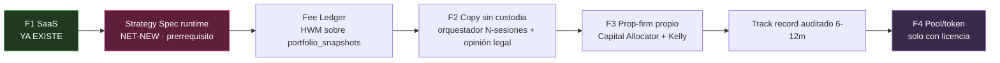

### 8.8 El riel de fondos: segregación, idempotencia y reconciliación

Este es el detalle prometido en §7.2.1. Mover dinero real de N usuarios entre venues exige tres garantías que hoy son **parciales o net-new**:

- **Segregación de fondos (subaccounts).** En el modelo non-custodial (§12.5) cada copiador opera SU cuenta con SUS keys (el SessionManager lo aísla). Para el prop-firm interno (F3, capital propio), se requiere un **fund ledger segregado** sobre subaccounts del exchange — net-new sobre `KuCoinRESTClient` — que separe el capital por tramo/Spec y nunca mezcle el del Treasury con el de un usuario. El **ledger contable** puede apoyarse en el módulo Wallet+Fineract de la plataforma como fuente de verdad de asientos; lo que sigue net-new es la segregación por tramo/Spec sobre subaccounts del exchange y el `clientOrderId` determinista. **Línea roja (ver [ARCH-PLATFORM-REUSE](../03-architecture/PLATFORM_REUSE.md#frontera-custodial--la-línea-roja)):** los fondos de F1/F2 son non-custodial (BYO-keys del usuario); **no** se mueven payouts de terceros vía Fineract (`UserToUser`/`WithdrawToIssuer` custodiarían saldos de terceros = "wallet con depósito previo" rechazado por DECISIONS §3 y §8.5). Solo el F3 (Treasury, capital propio) puede apoyar su contabilidad en Fineract sin cruzar la frontera.
- **Idempotencia de órdenes.** Sin un `clientOrderId` **determinista** por intención de trade, un reintento tras timeout puede duplicar una orden (clase de bug ya vista: duplicación de posición entre instancias fleet). Hoy hay reconciliación parcial (`syncOpenPositionsFromExchange`) pero falta el `clientOrderId` determinista que haga cada envío idempotente extremo a extremo.
- **Reconciliación contra el exchange, no contra SQLite.** El libro de PnL local mintió (`-$51` falso por PnL inflado, cierres externos no registrados). El riel debe reconciliar posiciones, fills y fees **contra el estado del exchange** al arrancar y periódicamente, y tratar al exchange como fuente de verdad. Esto es prerrequisito de cualquier fee ledger con HWM (§8.3): no se puede cobrar sobre un número que el propio sistema reconoce como poco fiable.

---

## 9. Autonomía y autoaprendizaje: el motor de IA

> **Tesis**: AnkaAI tiene dos bucles de auto-mejora que se retroalimentan: uno **rápido y seguro** (evolución de estrategias declarativas, construible una vez exista la Strategy Spec) y uno **lento y peligroso** (auto-mejora del propio código Go, moonshot en jaula). Cambiar una Spec es cambiar *datos*; cambiar `executeTrade()` es cambiar el motor mientras vuela.

### 9.1 Tres niveles de plasticidad

| Nivel | Qué muta | Quién lo hace hoy | Riesgo | Reversibilidad |
|---|---|---|---|---|
| **N1 — Parámetros** | umbrales, pesos, `keep_fraction`, breakeven | `autotuner.go`, `wick_learner.go`, `/reload` ✅ | Bajo | Instantánea (hot-swap) |
| **N2 — Estrategias** | la lógica declarativa (Strategy Spec) | **nadie aún** — la Spec es net-new | Medio | Por versión (rollback de spec) |
| **N3 — Código** | el runtime: `decision.go`, executors, indicadores, el gate | **nadie hoy** — moonshot | Alto | Solo vía Git + CI + revisión |

### 9.2 Bucle A — Evolución de estrategias (construible una vez exista la Spec)

Ninguna IA toca Go. El LLM (seam de generación de *sugerencias*: `feature_suggester.go` + `consensus.go` — **no** es aún un generador de Specs) emitiría una **Spec candidata completa, condicionada por evidencia de drift, no por intuición**. La **mutación es dirigida por datos** (post-mortem de trades cerrados desde `feature_store` + `feedback_loop.go` + `trade_history`), no aleatoria: detecta patrones reales (ej. "esta Spec pierde cuando entra en pullbacks junto al máximo en `trend_follow`" — bug documentado en el repo) y genera una variante que lo corrige. El `validation gate` es el predador darwiniano; la promoción shadow→live ya está modelada (`/reload` hot-swap en `internal/config/dynamic/store.go`); el `cmd/retrain/main.go` ya existe — falta el *scheduler* (Fase A del self-learning plan, hoy default OFF). **Prerrequisito duro:** sin el runtime de Strategy Spec (§7.1), este bucle no tiene sustrato.

### 9.3 Bucle B — Auto-mejora del CÓDIGO (🌙 moonshot honesto)

**Brutalmente honesto: esto NO existe hoy y es lo más peligroso del documento.** Una IA con permiso para modificar `executeTrade()` o el gate puede, en un PR sutilmente erróneo, vaciar la cuenta o —peor— *desactivar el propio gate que la frena* (el zorro reescribe el gallinero). N3 no es "darle el repo a un agente"; es un **pipeline de propuesta-bajo-jaula**:

- **Capa 0 — Lista negra**: cambios a `internal/risk/`, `internal/backtest/validator.go`, `risk_limits` del config y al propio pipeline de gates → **prohibidos al agente**. El agente no puede tocar lo que lo vigila.
- **Capa 1 — CI obligatorio**: `make test-all`, `make lint`, `make vet`, build verde. Sin verde, el PR ni se considera.
- **Capa 2 — No-regresión de comportamiento**: el backtest determinista (`internal/backtest/engine.go`, cost model de fees KuCoin) corre ANTES y DESPUÉS del diff sobre el mismo histórico. **Caveat ineludible:** esta capa es tan confiable como el backtest, y el backtest **tiene historial de mentir** (orden de velas newest-first, fees con `sum=0`, PnL inflado, todos documentados). Un oráculo que ya mintió no es una jaula confiable. **Regla:** el Bucle B no se abre hasta que el backtest esté validado contra PnL real reconciliado durante un periodo sostenido.
- **Capa 3 — Revisión humana obligatoria** (rol `admin`/`operator`): el agente *propone*, una persona *mergea*, **dos aprobaciones, nunca auto-merge**.
- **Capa 4 — Canary en shadow**: el binario con el cambio corre en paralelo a producción por N horas antes de promover.

**Idea audaz pero acotada — "El agente como autor junior permanente":** no buscamos un AGI que reescriba el sistema, sino un **contribuidor incansable de PRs pequeños y verificables**: deduplicar código, añadir tests faltantes, y sobre todo **despertar código dormido y documentado** (el repo tiene `parabolic_sar.go`, divergencias MACD, `btc_correlation_monitor.go` implementados pero dormidos esperando adaptación a `ai.Candle`). **Empezar por despertar lo dormido, no por reescribir lo vivo.** La jaula de salvaguardas es el verdadero entregable, no el agente. El agente sin jaula no es una feature: es un pasivo. **Firme:** el Bucle B queda fuera de H1 y H2.

### 9.4 El cierre del bucle dual

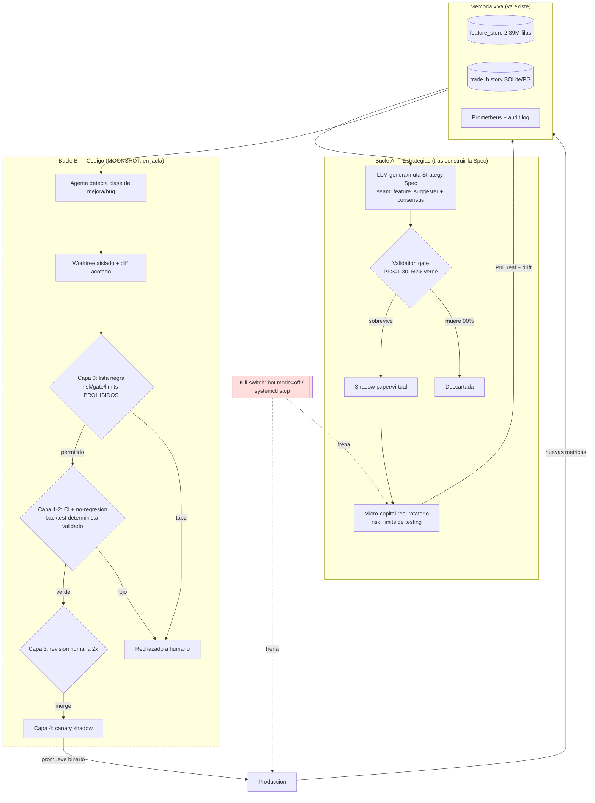

Ambos bucles se alimentan de la misma memoria viva: el Bucle A retroalimenta con PnL real, y el Bucle B (que **engorda el motor que mueve todas las vueltas**, §5) solo promueve binarios tras 4 capas de jaula + revisión humana. Las dos flechas del kill-switch recuerdan que **ningún bucle es soberano**.

**Recomendación de orden:** primero construir la Strategy Spec y cerrar el Bucle A end-to-end (donde está el valor económico inmediato); solo después, y solo tras validar el backtest contra PnL reconciliado, abrir el Bucle B por la tarea más segura posible (despertar indicadores dormidos bajo CI).

---

## 10. Colaboración masiva humanos + IA y gobernanza

### 10.1 La tesis: el edge no escala con un genio, escala con un gremio que mejora al árbitro

El cuello de botella no es técnico (el gate, el GBM y el self-learning ya existen): es **cuántas hipótesis de mercado distintas entran al embudo por día**. La apuesta: convertir ese embudo en un **mercado abierto de contribución** donde miles de humanos y agentes proponen estrategias, y el *único* árbitro de qué llega a dinero real es el gate. La diversidad de contribuyentes **no es decorativa: es alfa estadística** — mil autores con sesgos descorrelacionados producen un portafolio de edges descorrelacionados; el gate filtra el ruido, la masa provee la varianza.

**Pero el diferenciador real no es el leaderboard** (eso ya lo tienen Collective2/ZuluTrade). Es que **el gremio mejora al propio validador**: la comunidad actúa como **fuzzer adversarial del gate** (§10.5), y la reputación premia a quien predice fallos y destapa bugs del árbitro, no solo a quien gana. Un marketplace de señales rankea traders bajo un filtro fijo; AnkaAI deja que la masa **endurezca el filtro**.

### 10.2 El embudo de contribución (no hay puerta lateral al dinero real)

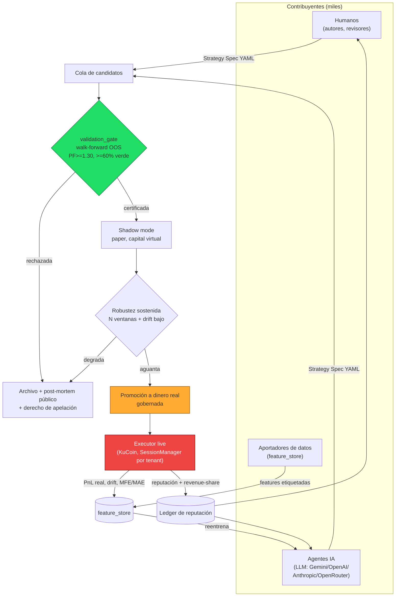

El contrato de entrada es la **Strategy Spec declarativa** (net-new, §7.1): un agente o un humano desconocido podrá subir una Spec sin tocar el binario. Mismo runtime para todos → rankings comparables y superficie de ataque casi nula. **Hasta que la Spec exista, este embudo es aspiracional.**

### 10.3 El Gremio de Estrategias (marketplace + reputación)

Se construye sobre `handler_ranked_pairs.go` (`/pairs/ranked`) y el dashboard Flutter: pasar de *rankear pares* a **rankear contribuciones**. El **ledger de reputación NO es un like**, es una función auditable de resultados ya medidos: PF/Sharpe OOS (`validator.go`), % ventanas verdes (`validation_service.go`), estabilidad post-promoción (`data_collector.go` + `trade_history`), capital gestionado sin blow-up (`sentinel.go`), y —sutil pero clave— **aciertos como revisor** (predijo que una Spec fallaría). La reputación de revisor crea incentivo real para revisar bien, no para inflar amigos. **Buildeable a corto plazo**: es una vista materializada sobre `trade_history` + verdicts, sin construir monetización.

### 10.4 Ligas y torneos: el descubrimiento como deporte

Un torneo es el gate corrido con ventana temporal compartida y ranking público:

- **Liga de Régimen**: torneos segmentados ("mejor Spec en RANGING + volTier extreme"), atacando la debilidad histórica del bot (sangra en mercados directionless). La masa encuentra edges en nichos que un solo equipo nunca exploraría.
- **Liga Shadow vs. Live**: ascender de división exige sostener métricas shadow→live; el público lo ve en tiempo real vía `internal/iatbws/hub.go`.
- **🌙 Torneo de IAs**: cada proveedor LLM como "jugador" autónomo; se mide qué modelo descubre edges más robustos por dólar de API (`internal/ai/cost/manager.go` ya monitorea costo). Moonshot — roza el Bucle B de §9.

### 10.5 Gobernanza: políticas, NUNCA resultados — y la comunidad como fuzzer del gate

El v2.0 tiene roles (`viewer/author/operator/admin`) pero **no governance participativa ni audit público de decisiones de ranking**. Esta visión la cierra con un principio: **los humanos gobiernan umbrales y excepciones, no resultados individuales** (qué estrategia sube lo decide el gate).

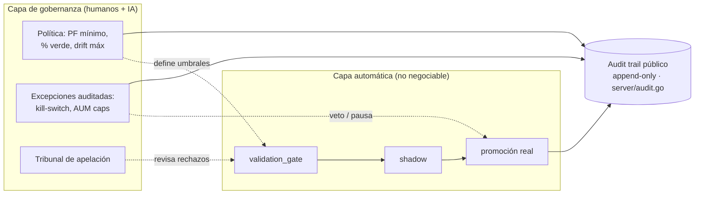

1. **Audit trail público de decisiones** (extiende `internal/mcp-trading/server/audit.go`): cada cambio de ranking, promoción y veto queda firmado y consultable. *Por qué subió esta Spec* deja de ser caja negra.
2. **Conflicto de interés explícito** (código, no buena fe): un operador **no puede aprobar la promoción a real de una Spec donde figura como autor** (regla anclada en el aislamiento por `userID` del SessionManager). Quórum de N operadores independientes sobre cierto AUM.
3. **Roles extendidos** sobre el multi-tenant: añadir `reviewer` y `arbiter` como `Features` en `subscription/models.go` (`FeatureReview`, `FeatureArbitrate`).
4. **El gremio como fuzzer adversarial del validador (el diferenciador):** cuando el gate rechaza, el autor puede pedir re-evaluación o señalar un **bug del gate** (ej. el bug de orden de velas newest-first del 06-01 habría hecho rechazar Specs válidas). Las apelaciones que destapan bugs reales suben la reputación del apelante. Resultado: **la comunidad endurece al propio árbitro** — un gremio que MEJORA AL ÁRBITRO, no un marketplace que solo lo obedece.

### 10.6 Por qué la diversidad mejora el conjunto (medible, no eslogan)

1. **Cobertura de régimen**: mil contribuyentes cubren los nichos que el equipo central ignora; el gate decide cuáles sirven.
2. **Ensamble descorrelacionado → menos drawdown**: promover varias Specs con curvas de PnL descorrelacionadas (medible en `trade_history`) reduce el drawdown agregado. La gobernanza capa AUM por Spec y exige descorrelación → el marketplace es un **constructor de portafolio**, no una lista de favoritos.
3. **Revisión adversarial distribuida**: la "verificación adversarial mató 5/6 intervenciones" (memoria del proyecto) fue *un* revisor; con miles incentivados por reputación, cada candidata recibe escrutinio adversarial antes de tocar dinero.

---

## 11. La educación como flywheel (educar, aprender, expandir)

La educación no es un módulo paralelo: es el **motor de adquisición de contribuyentes** (P4) y el **pipeline de IP de trading** (P8). Su materia prima ya existe — el bot registra el *por qué* de cada decisión (regime gate + ML gate + trend filter + voto LLM). La **Explainability API** expone ese árbol con una sola fuente de verdad y cuatro consumidores: ejecución real, sala de educación, replays y mejora del prompt del LLM.

### 11.1 El bucle económico de la educación (el corazón, no los cursos)

Lo que distingue a AnkaAI de cualquier academia de trading no es el contenido, sino que **la educación produce IP que entra al flywheel**:

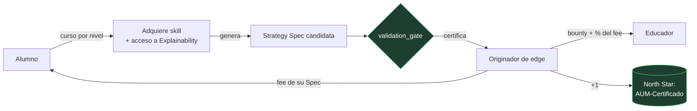

- **Replays explicados y cursos por nivel**: cada trade real cerrado es material didáctico narrado automáticamente desde `trade_history` + la Explainability API. Es la materia prima diferenciada (transparencia como dato), no cursos genéricos.
- **Educar produce capital**: cada alumno que produce una Spec que pasa el gate es un originador de edge; el educador cobra bounty + % del fee generado (§8.6). **La métrica de éxito de la educación NO es horas vistas, es Specs certificadas por cohorte** (§15).
- **Anti-survivorship en lo que se enseña**: los replays y leaderboards muestran también las estrategias retiradas y los drawdowns, no solo los aciertos (ver §12.3).

### 11.2 Expandir: del flywheel abstracto al crecimiento medible

"Expandir" (tercer verbo de P5) no es un eslogan; es ensanchar el embudo de §11.1 a lo largo de tres ejes operativos:

- **Cohortes/educadores como canal de adquisición.** Cada educador es un nodo que convierte alumnos en autores. El crecimiento de AUM-Certificado se descompone en: nº de educadores activos × alumnos/cohorte × tasa de conversión a Spec certificada × AUM medio por Spec. Esa cadena es la North Star instrumentada (§15), no "MAU".
- **Idiomas y contenido.** La sala de educación se entrega **reutilizando servicios de plataforma** (no infra a inventar): Chat `POST /internal/broadcasts` (con `ReferenceType='course'/'lesson'`) + Centrifugo para entrega en vivo, `notificationpush` (FCM/APNs) para offline, e `internal/filemanagement/messaging` (consumer de eventos ya implementado) para documentos/replays. Expandir idioma = localizar contenido, no reescribir el motor. Gaps reales (net-new sobre el broadcast existente): foro/topic público y targeting `role_based`/`geo`. Ver [ARCH-PLATFORM-REUSE](../03-architecture/PLATFORM_REUSE.md).
- **Jurisdicciones soportadas.** Expandir geográficamente está acotado por el geo-gating de §12.6 (cada país = reglas distintas): la lista de jurisdicciones soportadas es una variable de producto, no una promesa global.
- **🌙 Sesiones en vivo con expertos y contenido AR/voz**: aspiracional, post-tracción — una línea, no un pilar.

---

## 12. Seguridad, riesgo, ética, legal y salvaguardas

> **Postura**: esta visión solo merece existir si sobrevive a su propio adversario. Cada pilar es, simultáneamente, un vector de ruina.

| Pilar | El mismo pilar, leído por el adversario |
|---|---|
| Dinero real a escala | Pérdida real a escala (un bug ×N usuarios) |
| IAs mejoran el código | IAs introducen un backdoor / sesgo de supervivencia / bug de sizing |
| Mejora continua de estrategias | Sobreajuste continuo que el ranking premia |
| Colaboración masiva | Pump&dump coordinado, sybil, copy-trading tóxico |
| Educar y expandir | Consejo financiero no licenciado a no cualificados |
| Autonomía y autoaprendizaje | El bucle se cierra y nadie explica por qué perdió dinero ajeno |
| Múltiples exchanges + dinero real | Custodia de claves/fondos = entidad regulada de facto |
| Levantar capital | Captación de fondos del público = valores / fondo / casa de bolsa |

**Regla cero**: ninguna capacidad nueva se activa para un usuario externo hasta pasar su puerta. El default de todo lo nuevo es `OFF`.

### 12.0 Exposición PRESENTE: multi-tenant ya está encendido

> **🚨 Bloqueante inmediato, NO tarea de roadmap.** Verificado en `config.yaml`: `multi_user.enabled: true` ("ACTIVADO 2026-05-25: per-user BotManager/SessionManager en producción"), y `main.go:1524` lo cablea. Es decir, **el camino multi-tenant ya corre con dinero real**. Por tanto, los enforcement que separan "herramienta" de "entidad regulada" no son trabajo futuro: su ausencia o no-verificación es **exposición presente**. Concretamente, antes de admitir cualquier usuario externo adicional:
>
> 1. **Verificar que el chequeo `verifyNoWithdraw` está activo y en modo `block` en el path live.** El código existe (`internal/credentials/service.go`: `NoWithdrawEnforcement = "block"`, `verifyNoWithdrawKuCoin`/`verifyNoWithdrawBinance`), pero tiene un *fallback permisivo* para exchanges no soportados — auditar que ningún venue activo cae en ese fallback.
> 2. **Confirmar que las políticas RLS están realmente ENABLED en la base viva.** Las políticas existen (`migrations/operational/050_rls_policies.up.sql`, `ENABLE ROW LEVEL SECURITY` sobre `trade_history`, `portfolio_snapshots`, etc.) y dependen de que la capa de app fije `app.user_id` (ver `rls.go`). Hay que **verificar en producción** que están aplicadas y que ninguna conexión las elude — tener el SQL escrito no garantiza que esté activo.
> 3. **Reconciliación contra el exchange operativa** antes de cualquier accounting de fee.

### 12.1 Capital gating: escalera de 5 peldaños con freno de hombre muerto

El v2.0 define `paper → shadow → virtual → real`. La lente de riesgo lo endurece y lo hace **auto-degradante**, no una aprobación de una sola dirección.

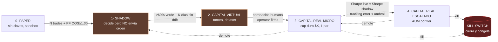

- **SHADOW reutiliza el `fuseExitDecision` shadow-mode del Active Profit Engine** (ya cableado): se extiende del *exit* a la *estrategia completa*.
- **El salto a real exige `tracking error` acotado**: comparar el PnL que la estrategia *dijo* en shadow vs. el que *hizo* en micro-real. Si divergen, demote automático. Esto ataca el agujero documentado (el `-$51 falso` por PnL inflado): **el sistema debe desconfiar de su propia contabilidad y reconciliar contra el exchange, no contra SQLite.**
- **Demote es de primera clase**, tan importante como la subida. Una Spec que driftea baja sola antes de que un humano reaccione.
- **Honestidad**: construible hasta el peldaño 3 con dinero **propio** del usuario en **su** cuenta. El peldaño 4 (AUM escalado de terceros) cruza a territorio regulado → §12.5, y exige el sistema de risk-limits jerárquico que hoy no existe (los `$2/$5` actuales son de testing, §7.1).

### 12.2 Kill-switch en tres anillos

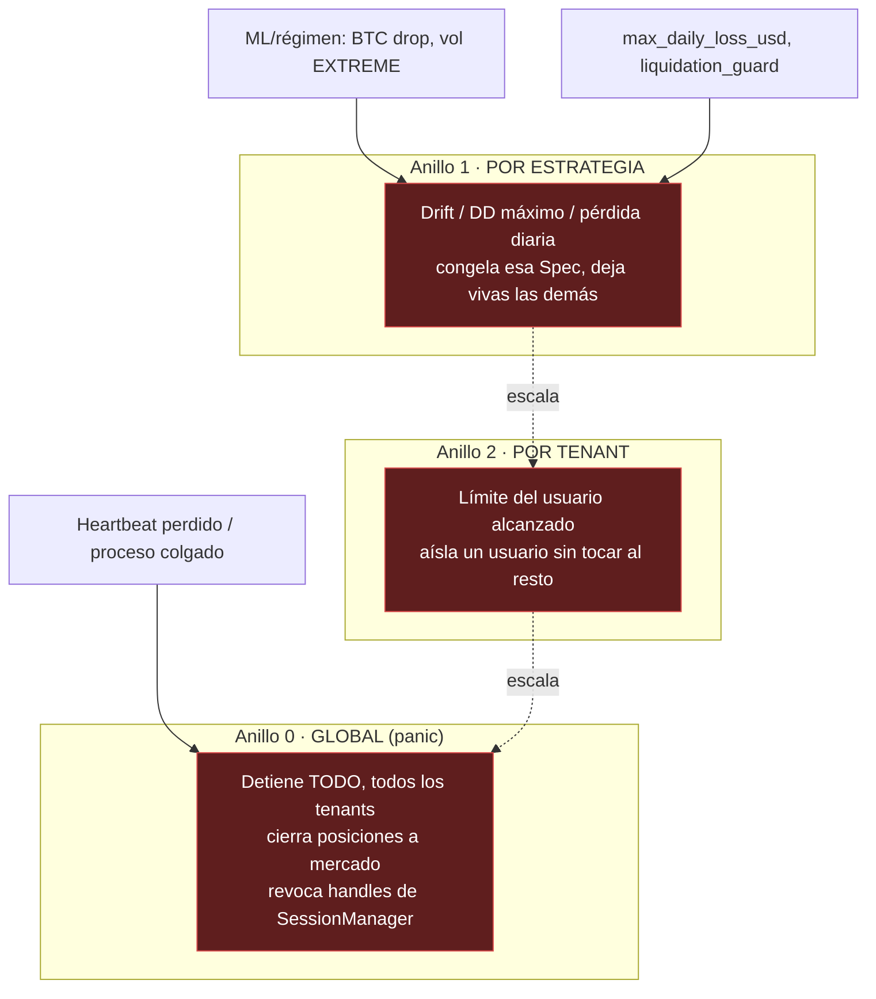

- **El kill-switch global vive FUERA del proceso del bot.** El bot corre bajo `systemd Restart=always` (nunca `nohup`/`pkill`).
- **🌙 Watchdog revoca-keys (NET-NEW, no existe):** un watchdog separado con autoridad para revocar las API keys vía el exchange (KuCoin lo permite) — el botón nuclear cuando ni cerrar posiciones responde. **Hoy NO está implementado**; es tarea bloqueante antes de copy-trading, no una nota al pie.
- **Dead-man's switch por heartbeat** sobre `internal/monitoring/` (Prometheus) — también a construir.
- **Canal de alerta (reutilizado, no net-new):** las alertas (señal, validación, demote, payout, kill-switch) salen por `notificationpush` (FCM/APNs: `POST /api/v1/notifications/send`, `GET /api/v1/users/:id/devices` para fan-out) + Chat broadcast + Centrifugo `personal:{user_id}`. El watchdog y el dead-man's switch siguen net-new; su *canal* reusa el rail push. **Gap conocido:** `notificationpush` NO persiste historial de entrega — para auditoría de payout F2/F3 reutilizar el **patrón outbox** (`internal/auth/domain/outbox_event.go`), no confiar en el historial efímero. Ver [ARCH-PLATFORM-REUSE](../03-architecture/PLATFORM_REUSE.md).
- **La IA NO puede desactivar el kill-switch.** Tunea umbrales dentro de un rango duro inmutable. El humano define la jaula.

### 12.3 Anti-overfitting y anti-leakage como ciudadanos de primera clase

El riesgo *silencioso* que más dinero quema: el ranking premia tramposas. La defensa nuclear ya existe (validation gate OOS + GBM con métricas OOS honestas). Vectores concretos a vigilar:

1. **Lookahead en la generación de Specs**: la `feature_store` debe servir features **as-of** (snapshot al timestamp de decisión); el `labeler.go` (etiquetado diferido) impone horizonte futuro — el entrenamiento nunca lee su propia etiqueta.
2. **Data snooping del bucle evolutivo**: si las top-N mutan y se re-validan sobre las mismas ventanas que las eligieron, se sobreajustan. Mitigación: **holdout congelado** que ninguna generación ha visto + TTL de verdicts (ya existe).
3. **Survivorship en el copy-trading**: el leaderboard **debe** mostrar las estrategias retiradas y sus drawdowns.
4. **El gate de la IA no juzga su propia mejora**: el gate es código determinista (`validator.go`), no una opinión del LLM. **Inmutable.**

### 12.4 Seguridad del sandbox e "IAs tocando código"

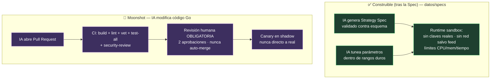

- **Auto-mejora de código = PRs, no `git push` autónomo** (alineado con §9.3). Lo difícil no es que la IA escriba el diff: es garantizar que un diff sutilmente sesgado (que afloje un guardrail de sizing) no pase — y que el backtest que lo juzga no esté mintiendo (§9.3, Capa 2).
- **Aislamiento del sandbox**: las Specs corren sin claves reales (el SessionManager solo entrega handles a estrategias promovidas), sin egress salvo el feed, con límites CPU/mem/tiempo. **El runtime de Spec en sandbox es net-new** (depende de §7.1).
- **Prompt-injection y poisoning**: el dato externo entra como **dato no confiable, nunca como instrucción**; la `validation/` de salidas del LLM y el `circuit_breaker.go` son el cimiento.
- **Supply chain**: el `gbm_*.pkl` promovido por el self-learning engine debe firmarse y hashearse en el `model_registry`, igual que una Spec.

### 12.5 Custodia de fondos y claves: la línea que define si somos entidad regulada

| Modelo | Quién tiene claves/fondos | Carga regulatoria | Veredicto |
|---|---|---|---|
| **A · Non-custodial** | El **usuario** mantiene sus claves en **su** cuenta; recibimos solo API key de *trade* (no *withdraw*) | Baja — somos software/herramienta | ✅ **Construible ya** (el SessionManager ya lo modela) |
| **B · Custodial / pooling** | **Nosotros** custodiamos fondos de terceros y operamos | Altísima: VASP/MSB, KYC/AML, licencias, capital regulatorio | 🌙 **Moonshot legal** — no tocar sin asesoría + partner licenciado |

**Reglas duras del modelo A — estado honesto de cada una:**

1. **API keys SOLO con permiso de trading, JAMÁS de retiro.** 🟡 **Parcial:** el chequeo existe (`verifyNoWithdraw` → `verifyNoWithdrawKuCoin`/`verifyNoWithdrawBinance`, `NoWithdrawEnforcement="block"`), pero tiene un **fallback permisivo** para exchanges no soportados (`Warn("unsupported exchange, skipping withdraw check")`). **Tarea bloqueante:** garantizar que el modo `block` está activo en el path live y que ningún venue activo cae en el fallback.
2. **Custodia de claves en reposo.** ✅ Cimiento real: `internal/credentials/` (AES-256-GCM + envelope encryption, providers `VaultTransitProvider`/`FileKeyringProvider`, soporta `rekey`) + `internal/twofa/`. **Corrección de un dato heredado erróneo:** *NO* hay un secreto JWT Kong hardcodeado en git. El código lee `os.Getenv("KONG_JWT_SECRET")` y hace `log.Fatal` si falta en producción (`main.go:1775`); solo en `MCP_SERVER_MODE=sandbox` genera un secreto **efímero aleatorio**. El riesgo real **no** es "está en git" sino que **el fallback efímero rompe la verificación de tokens entre reinicios/réplicas** — por eso `KONG_JWT_SECRET` debe estar siempre seteado y gestionado por KMS en producción.
3. **RLS por tenant.** 🟡 Escrita, **verificación pendiente**: las políticas existen (`migrations/operational/050_rls_policies.up.sql`) — NO están "disabled-bak". Pero RLS depende de que la capa de app fije `app.user_id`; hay que **confirmar en la base viva** que está ENABLED y que ninguna conexión la elude. Dado que `multi_user` ya corre (§12.0), esto es exposición presente.

> **Disclaimer arquitectónico**: mientras seamos modelo A, somos un *bring-your-own-keys trading tool*. En el segundo en que toquemos pooling/copy con fondos comunes (P8), cambiamos de categoría legal. **Esa transición es un proyecto en sí mismo, no una feature.**

### 12.6 Marco legal y ética

| Actividad | Riesgo legal | Mitigación | ¿Moonshot? |
|---|---|---|---|
| Bot opera la cuenta propia del usuario | Bajo (software tool) | ToS + disclaimer "no es consejo financiero" | No |
| Educación / replays / "por qué entró" | Consejo de inversión no licenciado si se lee como recomendación | Lenguaje educativo; disclaimers; gating por edad/jurisdicción | No, pero requiere disciplina editorial |
| Ranking + copy con performance-fee | **Asesoría/gestión de inversiones regulada** (no "borderline") | Solo non-custodial NO basta; exige opinión legal previa | 🟠 Frontera seria |
| Profit-split a operadores externos (prop-firm, capital propio) | Posible contrato de inversión / intermediación | Revisión legal aunque el capital sea propio | 🟠 Frontera seria |
| Pools / inversores externos | Captación de fondos del público = valores / fondo | Entidad licenciada, prospectos, KYC/AML, auditoría | 🌙 Sí |
| Multi-exchange, multi-jurisdicción | Cada país = reglas distintas | Geo-gating, lista de jurisdicciones soportadas | Operacionalmente caro |

**No negociables éticos:** (1) "performance pasada ≠ futura" en grande y por defecto; (2) cero promesas de rendimiento; (3) consentimiento informado de riesgo antes del primer dólar real (auditado vía `internal/mcp-trading/server/audit.go`, es código no PDF); (4) transparencia post-hoc vía Explainability API; (5) KYC + verificación de edad antes de capital real (federable al stack Auth de Rantipay — KYC levels, UserRegistry chaincode).

### 12.7 Síntesis riesgo vs. construibilidad

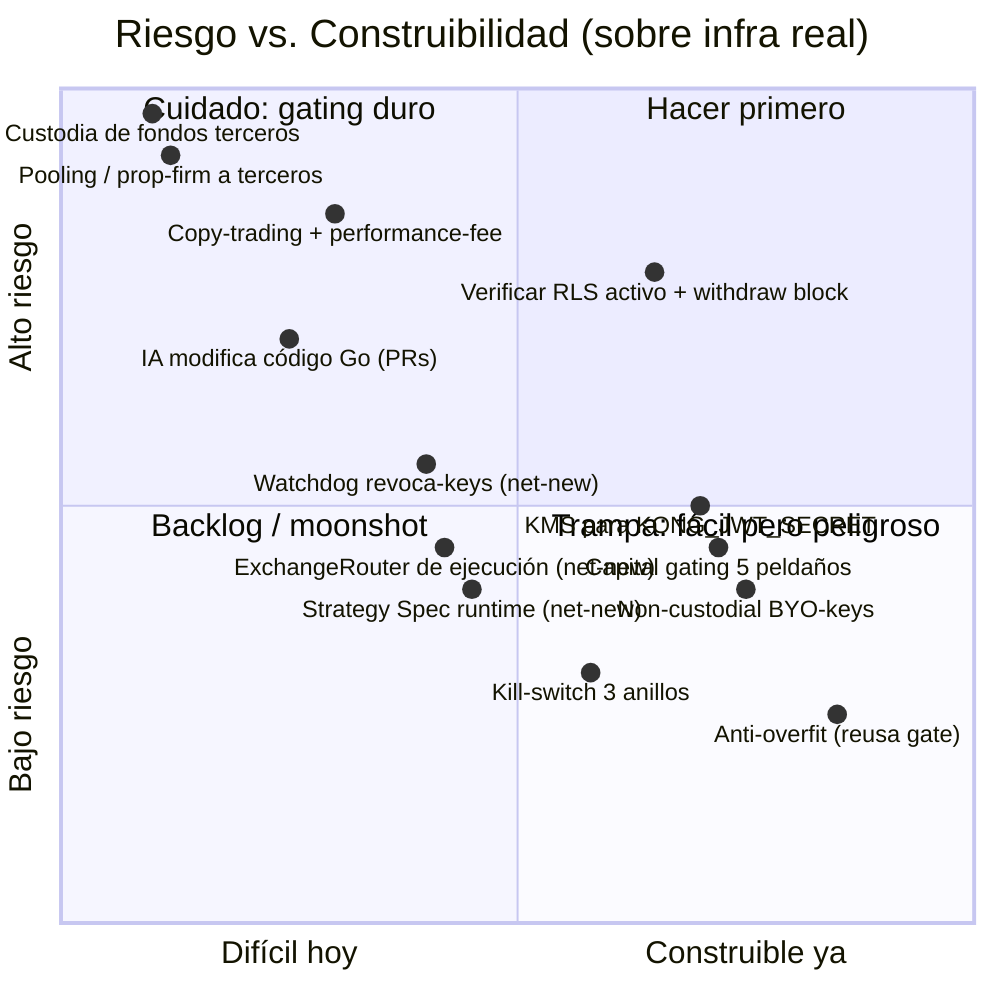

---

## 13. Roadmap por horizontes

```mermaid
flowchart LR
    subgraph H0["H0 · BLOQUEANTE INMEDIATO (multi_user ya está ON)"]
        H0a[Verificar withdraw=block activo en path live]
        H0b[Confirmar RLS ENABLED en base viva]
        H0c[KMS para KONG_JWT_SECRET + reconciliación contra exchange]
    end
    subgraph H1["H1 · Cercano — anclar y endurecer"]
        H1a[Strategy Spec: esquema + parser + runtime NET-NEW]
        H1b[Activar self-learning + scheduler retrain]
        H1c[Capital gating 5 peldaños + kill-switch 3 anillos]
        H1d[Generador de Strategy Specs por LLM → gate]
        H1e[Ledger de reputación + audit público de ranking]
    end
    subgraph H2["H2 · Medio — escalar y abrir"]
        H2a[ExchangeRouter de EJECUCIÓN + adapter Binance real]
        H2b[Fee Ledger + HWM + reconciliación → Copy F2 + opinión legal]
        H2c[Prop-firm interno F3 + Capital Allocator + risk-limits jerárquicos]
        H2d[Ligas/torneos por régimen + roles reviewer/arbiter]
        H2e[Watchdog revoca-keys + fund ledger segregado]
        H2f[Despertar código dormido vía Bucle B en jaula]
    end
    subgraph H3["H3 · Moonshot — solo con licencia + track record"]
        H3a[IA modifica lógica viva de trading]
        H3b[Pool tokenizado F4 / custodia de terceros]
        H3c[SOR / arbitraje cross-exchange]
        H3d[On/off-ramp fiat + puente Rantipay payments]
        H3e[Torneo de IAs autónomas generadoras]
    end
    H0 --> H1 --> H2 --> H3
    classDef block fill:#5f1e1e,stroke:#d94a4a,color:#fff
    classDef now fill:#1f3a1f,stroke:#4caf50,color:#fff
    classDef mid fill:#1e3a5f,stroke:#4a90d9,color:#fff
    classDef moon fill:#3a2a4a,stroke:#a06bd6,color:#fff
    class H0 block
    class H1 now
    class H2 mid
    class H3 moon
```

**Bloqueantes inmediatos (H0, no opcionales, porque `multi_user` ya corre):** verificar withdraw=block en vivo, confirmar RLS ENABLED en la base, KMS para `KONG_JWT_SECRET`, reconciliación de PnL contra el exchange. **Orden honesto:** primero H0 (cerrar la exposición presente) + construir la Strategy Spec (prerrequisito de todo el embudo); luego cerrar el Bucle A con micro-capital real; después escalar exchanges (ExchangeRouter de ejecución) y abrir copy/prop-firm **con opinión legal previa**; y solo entonces —con licencia y track record— los moonshots de H3.

---

## 14. Qué YA existe vs. qué construir

| Capacidad | Estado | Anclaje real |
|---|---|---|
| Servidor MCP 105 herramientas (JSON-RPC 2.0) | ✅ Real | `internal/mcp-trading/` |
| Integración multi-exchange GoCryptoTrader (gRPC) | ✅ Real (cabida ~24 venues) | `internal/gct/client.go` |
| KuCoin operando con **dinero real** | ✅ Real | `config.yaml` `sandbox:false`, `kucoin_rest_client.go` |
| Bots de scalping autónomos (multi-par, bidireccional) | ✅ Real | `internal/scalping/` |
| Validation gate walk-forward OOS (PF≥1.30, ≥60% verde) | ✅ Real, en producción | `validation_service.go`, `validator.go` (`MinProfitFactor=1.3`, `MinConsistency=0.6`) |
| Pipeline ML/GBM votante (PF 2.611, AUC 0.816, WR 61%) | ✅ Real, cableado a live | `cmd/ml-server/`, `data/models/gbm_*.pkl` + `.meta.json` |
| `feature_store` (~2.39M filas) para reentrenamiento | ✅ Real | `internal/ai/feedback/labeler.go` |
| Self-learning engine (autotuner, feedback, wick) | 🟡 Implementado, **default OFF** | `internal/ai/learning/` |
| Active Profit Engine (wick/partial/trailing core) | 🟡 Core real; continuation/ladder/fuse en roadmap | `internal/services/ai_trading_bot.go` |
| LLM multi-proveedor (Gemini/OpenAI/Anthropic/OpenRouter/Groq) + consenso | ✅ Real | `internal/ai/llm/`, `consensus.go` |
| **Multi-tenant SaaS + SessionManager (ENCENDIDO en prod)** | ✅ Real y **ACTIVO** (`multi_user.enabled:true`) | `session_manager.go`, `main.go:1524`, `subscription/models.go` |
| Custodia cifrada por sobre (Vault/file keyring, rekey) + 2FA | ✅ Real | `internal/credentials/`, `kms/`, `internal/twofa/` |
| Risk engine + kill-switch + liquidation guard + vol classifier | ✅ Real | `internal/risk/`, `internal/ai/volatility/`, `sentinel.go` |
| App Flutter + WebSocket + FCM/APNS | ✅ Real | `ankamobil/`, `internal/iatbws/hub.go` |
| Compliance / audit logging | ✅ Real | `internal/mcp-trading/server/audit.go` |
| `cmd/retrain` (reentrenamiento) | ✅ Real, falta scheduler | `cmd/retrain/main.go` |
| Chequeo de permiso withdraw en API keys | 🟡 Existe, fallback permisivo | `credentials/service.go` (`verifyNoWithdraw`, `NoWithdrawEnforcement="block"`) |
| RLS por tenant | 🟡 Escrita, verificación-activa pendiente | `migrations/operational/050_rls_policies.up.sql` + `rls.go` |
| Superficie multi-exchange **read-only** (matriz precios) | ✅ Real (NO enruta órdenes) | `internal/exchange/router.go` (*"performs NO order placement"*) |
| **Strategy Spec declarativa (tipo + parser + runtime)** | ❌ **NET-NEW · prerrequisito Tier-0 de todo el embudo** | no existe (`grep StrategySpec` → 0) |
| **ExchangeRouter de EJECUCIÓN (enrutar órdenes de verdad)** | ❌ **NET-NEW** (hoy hardcode `c.kucoinClient`) | `client.go:468,671`; binance `enabled:false` |
| **Adapter de ejecución Binance/OKX sobre GCT** | ❌ Construir | sobre GoCryptoTrader |
| **Fund ledger segregado (subaccounts)** | ❌ Construir | nuevo, sobre `KuCoinRESTClient` |
| **Idempotencia de órdenes (`clientOrderId` determinista)** | 🟡 Reconciliación parcial | `syncOpenPositionsFromExchange`; falta `clientOrderId` |
| **Fee ledger + HWM accounting** | ❌ Construir | vista sobre `portfolio_snapshots` + `trade_history` |
| **Scheduler de reentrenamiento + promoción shadow→live** | 🟡 Piezas existen, falta agendar | self-learning plan, Fase A |
| **Generador de Strategy Specs por IA** | ❌ Construir (no es `feature_suggester`) | `feature_suggester` emite *features*, no Specs |
| **Ledger de reputación + audit público de ranking** | ❌ Construir (vista sobre datos existentes) | `validator.go` + `audit.go` |
| **Explainability API** | 🟡 Materia prima existe (el "por qué" se registra) | árbol de decisión del bot |
| **Copy-trading sin custodia (orquestador N-sesiones + motor copy)** | ❌ Construir (F2) + frontera legal | sobre SessionManager + gate |
| **Prop-firm interno + Capital Allocator + risk-limits jerárquicos** | ❌ Construir (F3) | sobre coordinator + sentinel |
| **Watchdog revoca-keys + dead-man's switch** | ❌ Construir | sobre `internal/monitoring/` + API exchange |
| **Auto-mejora de código (Bucle B en jaula)** | 🌙 Moonshot (fuera de H1/H2) | worktree + CI + canary |
| **Pool tokenizado / custodia de terceros** | 🌙 Moonshot legal | requiere licencia |
| **SOR / arbitraje cross-exchange** | 🌙 Moonshot prematuro | requiere AUM que lo justifique |
| **On/off-ramp fiat** | ❌ Construir (proveedor externo) | `RampAdapter` + KYC/AML |

---

## 15. Métricas de éxito (North Star)

> **North Star Metric: Capital Real Bajo Gestión de Edges Certificados (AUM-Certificado).**
> El total de dólares reales operando bajo estrategias que pasaron el gate OOS y sobrevivieron en shadow. Esta métrica es honesta porque **solo crece si el flywheel completo funciona**: requiere educación (genera autores) + colaboración (llena el embudo) + gate (certifica) + dinero real (ejecuta) + capital (financia). No se puede inflar con marketing ni con paper.

**Descomposición de la North Star (cómo "expandir" se vuelve medible, §11.2):**

> AUM-Certificado ≈ (educadores activos) × (alumnos/cohorte) × (tasa de conversión a Spec certificada) × (AUM medio por Spec certificada sobreviviente en shadow)

**Métricas de apoyo, por pilar:**

| Pilar | Métrica | Fuente |
|---|---|---|
| Dinero real (P1) | PnL neto realizado reconciliado contra exchange (no SQLite) | `trade_history` + reconciliación |
| Estrategias (P3) | Specs certificadas vigentes / Specs propuestas (tasa de supervivencia del gate) | verdicts del gate |
| Estrategias (P3) | Robustez: % ventanas verdes y tracking error shadow↔live | `validation_service.go` |
| Colaboración (P4) | Hipótesis distintas que entran al embudo por día; descorrelación del portafolio promovido | cola de candidatos, `trade_history` |
| Educación (P5) | **Alumnos que producen ≥1 Spec certificada (originadores de edge)** — no horas vistas | ledger de reputación |
| Expansión (P5) | Educadores activos × conversión a Spec certificada × jurisdicciones soportadas | embudo §11.2 |
| Autonomía (P6) | Mejora del PnL ajustado por riesgo entre versiones del modelo; nº de retrains promovidos | `model_registry` |
| Capital (P8) | AUM-Certificado, performance fee generado, profit-split repartido | fee ledger (net-new) |
| Seguridad | Tiempo a kill-switch; nº de demotes automáticos antes de intervención humana; incidentes de custodia (objetivo: 0) | audit log |

---

## 16. Decisiones abiertas

1. **Strategy Spec — esquema fundacional (Tier-0 bloqueante).** Es la dependencia que el v2.0 marcaba como prerrequisito y que el v3.0 confirma inexistente. ¿Qué expresa exactamente una Spec (señales, gestión de posición, régimen, límites), y quién posee/versiona su esquema? **Es el primer documento a redactar (`docs/specs/STRATEGY_SPEC.md`) y el primer runtime a construir** — sin él, P3/P4/copy/sandbox/Bucle A no arrancan.
2. **Modelo de ejecución del capital**: ¿cada usuario/estrategia corre su propio bot, o comparten un executor centralizado con cuotas de riesgo? Recomendación tentativa: non-custodial por sesión para copy (F2); executor central con cuotas para prop-firm propio (F3).
3. **Cobro del performance fee**: ¿débito vía la cuenta del exchange (complejo) o wallet de plataforma con depósito previo? Cuello de botella legal/operativo del F2, **subordinado a la opinión legal sobre régimen de asesor/gestor**.
4. **Frontera del Bucle B**: ¿qué módulos exactos entran en la lista negra de la Capa 0 además de `risk/`, `validator.go` y `risk_limits`? ¿Quién mantiene esa lista? ¿Y qué define "backtest validado contra PnL real" como condición de apertura?
5. **Mutación dirigida por datos**: ¿qué data entra a la mutación — ranking puro vs. post-mortem de drift? (afecta anti-data-snooping de §12.3).
6. **Jurisdicción y estructura legal** para F2/F3/F4: ¿sandbox regulatorio, jurisdicción cripto-friendly, o partner licenciado (white-label)?
7. **Federación de identidad/KYC** con el stack Auth de Rantipay: **resuelta en [DECISIONS §7](DECISIONS.md)** — el Auth (:10100) ya emite JWT con `user_level` y expone `GET /api/v1/internal/permissions/:userID` (= rail de nivel KYC por REST, sin tocar el chaincode). El alcance abierto se reduce a: timing del cableado OIDC (el issuer OIDC es net-new en el Auth) y qué nivel KYC exigir por flujo de capital.
8. **Pesos del robustness score** en el ranking (penalización de overfitting): ¿valores concretos y quién los gobierna (política, no resultado — §10.5)?

---

## 17. Nota de procedencia

Este documento (v3.0) es la fusión de:

- La **VISION v2.0** (archivada en `99-archive/VISION_v2.0.md`), de la que se conservan los cinco pilares fundacionales — **Strategy Spec declarativo, validation gate, ranking, permisos por rol y disciplina de documentación**. Corrección honesta respecto al v2.0: de esos cinco, cuatro están anclados a código real, pero el **Strategy Spec no existe todavía** (era *documento a crear* en el v2.0 y sigue siéndolo); este v3.0 lo re-etiqueta como ❌ prerrequisito Tier-0 a construir, no como infra heredada. El v3.0 eleva el norte de "laboratorio social educativo" a **organismo de formación de capital** donde educación y dinero real son los dos extremos del mismo flywheel, eleva el ranking a "ledger de reputación" (§10.3) y extiende los permisos con `reviewer`/`arbiter` (§10.5).
- **Seis lentes de diseño**: propósito y narrativa única; modelo económico y levantamiento de capital; IA autónoma, autoaprendizaje y auto-mejora de código; colaboración masiva humanos+IA y gobernanza; conexión con dinero real, exchanges e integración de componentes; riesgo, seguridad, ética y marco legal.
- Una **verificación exhaustiva del código en producción** que ancla cada afirmación a archivos reales del repositorio o la etiqueta explícitamente como 🌙 *moonshot*. Esta edición **corrigió tres datos heredados erróneos**: (a) el "secreto JWT Kong hardcodeado en git" es falso — el código usa `os.Getenv` con `log.Fatal` en producción (§12.5); (b) `binance` está `enabled:false`, el multi-exchange de ejecución es net-new completo (§7.2.1); (c) `internal/compliance/` no existe — el audit vive en `internal/mcp-trading/server/audit.go`. Y elevó un hallazgo: `multi_user.enabled:true` ya corre en producción (§12.0), lo que convierte varios "gaps de roadmap" en exposición presente (H0 del roadmap).

Toda afirmación ambiciosa está, o anclada a infraestructura que ya opera, o marcada como moonshot con su bloqueador real (capital semilla, licencia regulatoria, o I+D de la jaula de auto-mejora). El proyecto ya tiene gran parte de los frenos —gate, sentinel, gating por config, audit, SessionManager, custodia cifrada—; lo que falta no es solo tecnología sino **(1) construir la plomería net-new que el flywheel da por sentada** (Strategy Spec, ExchangeRouter de ejecución, fee/fund ledger, copy-orchestrator), **(2) verificar que los enforcement ya escritos están realmente activos** (withdraw=block, RLS) dado que el multi-tenant ya corre, y **(3) la disciplina de no encender lo que no se puede frenar.**
